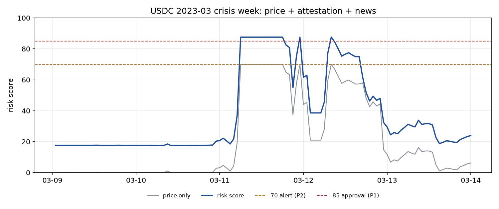
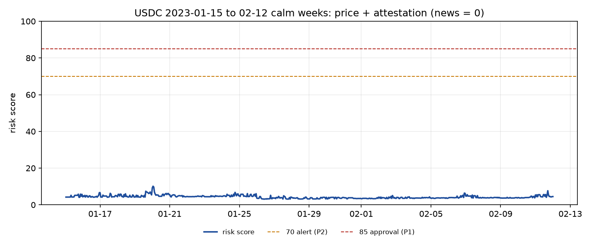

# 위험 점수 비중·만점 지점 v1 — 근거 문서

작성: Sejin (재석 담당분 인수, 2026-11-16 중간 점검 결정) · 작성일 2026-11-17

이 문서는 두 번에 나눠 썼다. **1~3장은 후보별 점수를 계산하기 전에 먼저 커밋했다**(사전 등록).
4장부터는 그 후보만 백테스트한 결과다. 결과를 본 뒤 후보를 더하거나 숫자를 고치지 않았다.

## 1. 왜 다시 정하나

지금 비중(`_BASELINE_WEIGHTS`)으로는 2023-03 USDC 사태의 최고점이 64.5점이라 70점(경보)·85점(사람 승인)
기준선을 한 번도 넘지 못한다. 2023년에는 대량 상환·유동성 쏠림 데이터가 없어 그 두 항목(합 0.30)이 늘
0점이고, 남은 비중의 최대가 70점이기 때문이다. 기준선(70·85)은 팀 확정값이라 바꾸지 않는다.

## 2. 통과 조건 (전부 만족해야 합격)

1. 평상시 4주(2023-01-15~02-12)에 70점을 한 번도 넘지 않는다 (뉴스=0으로 계산)
2. 2023-03 사태에서 70점과 85점을 둘 다 넘는다
3. 뉴스 신호 하나만으로는 70점을 넘지 않는다
4. 비중 합 = 1
5. 숫자마다 한 줄 근거가 있다

## 3. 사전 등록 — 원칙과 후보 (백테스트 전)

### 3-1. 후보를 정하기 전에 본 것과 보지 않은 것

- **봤다**: 평시 4주 이탈폭 범위(최대 42.3bps, 99% 지점 20bps), 사태 주간의 가격 경로(03-11 04:00 −30bps →
  05:00 −138bps → 06:00 −670bps → 08:00 −1,373bps), 시점별 공시 값, 뉴스 신호가 켜진 구간.
- **보지 않았다**: 아래 후보들의 시각별 점수와 기준선 돌파 시각. 이 장을 커밋한 뒤에 계산한다.
- 가격 경로를 이미 봤으므로 "사태를 전혀 모르고 정한 숫자"는 아니다. 그래서 숫자는 아래 원칙과 어림수로만
  정하고, 사태의 특정 시각(예: 05:00의 −138bps)에 기준선이 걸리도록 맞추지 않는다.

### 3-2. 원칙

- **원칙 1 — 근거 하나로는 사람 승인(85점)까지 가지 않는다.** 가격 하나만으로도 운영자 알림(70점)은 나가야
  한다(뉴스 규칙이 놓친 이탈도 알려야 하므로). 그러나 85점은 가격에 다른 근거(뉴스·상환·유동성)가 겹칠
  때만 넘는다. 뉴스 하나만으로는 70점도 넘지 않는다(조건 3).
- **원칙 2 — 나머지 네 항목은 같은 작은 비중의 보조 근거다.** 대량 상환·유동성 쏠림은 2023년 데이터가 없어
  검증할 수 없고, 공시 두 항목(현금 비중·공시 경과일)은 사태 전후로 값이 거의 같아(현금 0.2034 vs 평시
  0.2369~0.2586) 사태를 가려내지 못했다. 근거 없이 차등을 두지 않고 넷을 같게 둔다.
- **원칙 3 — 만점 지점은 사태 데이터가 아니라 평시 잡음과 통용 기준으로 정한다.**

### 3-3. 비중 (모든 후보 공통)

| 항목 | 현재 | 후보 | 한 줄 근거 |
| --- | ---: | ---: | --- |
| 가격 이탈폭 `peg_deviation_bps` | 0.50 | **0.70** | 다른 입력이 하나도 없어도 가격만으로 70점에 닿는 최소 비중 (원칙 1) |
| 뉴스 `news_risk_flag` | 0.10 | **0.14** | 1에서 가격과 보조 넷을 뺀 나머지. 단독 14점이라 70에 못 미치고(조건 3), 가격 70에 겹치면 84점 |
| 대량 상환 `redemption_volume_usd` | 0.20 | **0.04** | 보조 근거. 0.05로 두면 2023년 최대가 84.5점이라 85를 넘을 수 없어 0.04 (아래 계산) |
| 유동성 쏠림 `pool_imbalance_ratio` | 0.10 | **0.04** | 위와 같음 (원칙 2: 넷을 같게) |
| 현금 비중 `reserve_cash_ratio` | 0.05 | **0.04** | 위와 같음 |
| 공시 경과일 `attestation_age_days` | 0.05 | **0.04** | 위와 같음 |
| 합 | 1.00 | **1.00** | 조건 4 |

보조 비중을 0.04로 정한 계산: 보조 넷을 각각 w라 하면 가격+뉴스 = 1 − 4w. 2023년에는 상환·유동성이 0점이고,
공시 두 항목의 실제 기여는 현금 (1 − 0.2034) = 0.80, 경과일 약 0.1(6~11일 ÷ 90일)이다. 따라서 2023년에 낼 수
있는 최대는 (1 − 4w) + 0.9w = 1 − 3.1w. 85점을 넘으려면 w < 0.048이어야 하므로 0.05는 안 되고, 그 아래
어림수 0.04를 쓴다(최대 약 87.6점). 이 숫자는 설계 제약("2023년에 85를 넘을 수 있어야 한다")에서 나온 것이지
보조 항목이 4%만큼 중요하다는 실증이 아니다.

### 3-4. 후보 — 가격 이탈폭의 만점 지점만 다르다

| 후보 | 만점 지점 | 뜻 | 정한 근거 (원칙 3) |
| --- | ---: | --- | --- |
| K1 | 500bps (5%) | 현행 유지. 비중만 바꾼다 | 바꾸는 것이 가장 적다 |
| K2 | 200bps (2%) | 2% 이탈이면 가격 항목 만점 | 평시 4주 최대(42bps)의 약 5배. 법정화폐 담보 코인의 시간 종가가 2% 벗어나면 이견 없는 이탈 |
| K3 | 100bps (1%) | 1% 이탈이면 가격 항목 만점 | 흔히 쓰는 "1% 이탈 = 디페그" 기준. 평시 최대(42bps)의 약 2.4배 |

참고로 함께 계산해 표에 싣는 것(선택 대상 아님):

- **K0 현행**: 지금 비중·만점 지점 그대로. 조건 2를 통과하지 못한다는 출발점.
- **X1 뉴스 비중 큼** (가격 0.50 / 뉴스 0.34 / 보조 0.04×4, 만점 500bps): 원칙 1(가격만으로 70점)에 어긋나
  원칙 단계에서 탈락시킨 안. 조건만 보면 어떻게 나오는지 비교용으로만 계산한다.

만점 지점이 가격만의 문제인 이유: 뉴스는 0/1이고, 상환·유동성은 검증 데이터가 없고, 공시 두 항목의
정규화(현금 `1 − 값`, 경과일 `÷ 90일`)는 [손 해부 문서 5장](offchain_attestation_anatomy.md)이 방향 자체를
재검토하라고 지적한 항목이라 이번 범위(비중·만점 지점)에서 손대지 않는다.

### 3-5. 선택 규칙

1. K1·K2·K3 가운데 조건 1~4를 모두 통과하는 것만 남긴다.
2. 남은 것 중 **가장 단순한 것**(현행에서 바꾸는 것이 가장 적은 것 — K1 → K2 → K3 순)을 고른다.
3. 통과한 후보끼리 기준선 돌파 시각이 달라도 그것으로 고르지 않는다(사태 데이터에 맞추는 일이 되므로).
   다른 점은 문서에 그대로 적는다.

### 3-6. 백테스트 방법

- 시각마다 **그 시각의 값만** 넣는다: 그 시각의 가격·이탈폭, 그 시각에 공개돼 있던 최신 공시의 현금·국채 비중,
  발행일(당일 마지막 초)부터의 경과일, 그 시각의 뉴스 신호. 엔진은 지표별 최댓값을 쓰므로 과거 값을 섞지 않는다
  (ThreatWatch-AI `scripts/build_depeg_replay.py`와 같은 규칙).
- 평시 4주는 가격 + 공시로 계산하고 뉴스는 0으로 둔다. 평시 시간별 뉴스 파일이 없기 때문이다. 근거:
  [평시 표본](news_2023_calm_sample.md) 본표 21건에 기준표 v2.1을 적용하면 A/B 0건(C 1건)이다. 다만 이것은
  고른 21건의 결과이지 4주 전체에 뉴스 신호가 한 번도 켜지지 않았다는 증명은 아니다.
- 조건 3은 "가격 0bps + 뉴스 1 + 공시가 낼 수 있는 최악값(현금 0, 경과일 90일 이상)"으로 본다.

---

아래부터는 3장을 커밋한 뒤(`7e17cd0`) 계산한 결과다.

## 4. 결과 — 조건 5개 통과 표 (선택: K1)

**K1을 골랐다: 비중만 바꾸고 가격 만점 지점 500bps는 그대로 둔다.** K1·K2·K3가 모두 조건을 통과했고,
3-5절 규칙대로 그중 바꾸는 것이 가장 적은 K1이다.

| 조건 | 결과 | 값 |
| --- | --- | --- |
| 1. 평상시 4주에 70점을 넘지 않음 | 통과 | 672시간 중 오경보 0. 최고 10.13점 |
| 2. 사태에서 70·85를 둘 다 넘음 | 통과 | 둘 다 2023-03-11 06:00Z에 처음 넘음(87.55점). 사태 최고 87.6점 |
| 3. 뉴스 하나만으로는 70 미만 | 통과 | 가격 0bps + 뉴스 1 + 공시 최악값 = 22점. 가격 외 다섯 항목이 전부 최대여도 30점 |
| 4. 비중 합 = 1 | 통과 | 0.70 + 0.14 + 0.04 × 4 = 1.00 |
| 5. 숫자마다 한 줄 근거 | 통과 | 3-3절 표, 3-4절 표 |

조건 2의 시각을 기준점과 비교하면:

| 기준선 | 처음 넘은 시각 (UTC) | 최저점(03-11 08:00) 전 | −50bps(03-11 05:00) 전 |
| --- | --- | ---: | ---: |
| 70점 (경보) | 03-11 06:00 | 2시간 | **−1시간 (1시간 뒤)** |
| 85점 (사람 승인) | 03-11 06:00 | 2시간 | **−1시간 (1시간 뒤)** |

70점 이상이던 시간은 27시간(03-11 06:00 ~ 03-12 16:00 사이), 85점 이상은 15시간이다.





조건 1~4는 `tests/test_weights_conditions.py`로 고정했다. 평시는 뉴스=0으로 계산했는데, 뉴스가 4주 내내 켜져
있었다고 가정해도 최고 약 24점이라 70에 닿지 않는다(같은 테스트 파일에서 확인).

## 5. 후보별 결과

| 후보 | 사태 최고점 | 70 첫 돌파 | 85 첫 돌파 | 가격만 최고점 | 평시 최고점 | 뉴스 단독 (최악값) | 조건 | 결정 |
| --- | ---: | --- | --- | ---: | ---: | ---: | --- | --- |
| K0 현행 | 64.50 | 넘지 못함 | 넘지 못함 | 50.00 | 9.49 | 20.00 | 2 탈락 | 비교용 |
| **K1** 비중만, 만점 500bps | **87.60** | 03-11 06:00 (2h 전) | 03-11 06:00 (2h 전) | 70.00 | 10.13 | 22.00 | 1~4 통과 | **선택** |
| K2 만점 200bps | 87.62 | 03-11 06:00 (2h 전) | 03-11 06:00 (2h 전) | 70.00 | 19.02 | 22.00 | 1~4 통과 | 탈락 — K1이 더 단순 |
| K3 만점 100bps | 87.65 | 03-11 05:00 (3h 전) | 03-11 05:00 (3h 전) | 70.00 | 33.82 | 22.00 | 1~4 통과 | 탈락 — K1이 더 단순 |
| X1 뉴스 비중 큼 | 87.60 | 03-11 06:00 (2h 전) | 03-11 06:00 (2h 전) | 50.00 | 8.44 | 42.00 | 1~4 통과 | 원칙 1 위반 (등록 때 제외) |

탈락 이유:

- **K0**: 2023년에 낼 수 있는 최대가 64.5점이라 기준선에 닿지 않는다(조건 2).
- **K2**: 조건은 통과한다. 이 사태에서는 K1과 돌파 시각까지 같다(가격이 한 시간 만에 −138bps에서 −670bps로
  떨어져 200bps와 500bps를 같은 시간에 지난다). K1보다 바꾸는 것이 많아 선택 규칙에서 밀린다.
- **K3**: 조건은 통과하고 돌파가 한 시간 이르다(05:00, −50bps 선과 같은 시각). **돌파 시각이 이르다는 이유로
  고르지 않는다고 미리 정했으므로**(3-5절 3번) 선택하지 않았다. 평시 최고점이 33.8점으로 K1의 세 배다.
- **X1**: 조건 1~4는 통과하지만 가격만으로는 최고 50점이라, 뉴스 규칙이 놓친 이탈에는 경보가 나가지 않는다.

## 6. K1을 고르면서 감수하는 것

- **만점 지점 500bps는 느리다.** K1에서는 뉴스가 켜져 있어도 이탈폭이 약 375bps(3.7%)를 넘어야 70점,
  약 482bps를 넘어야 85점이다. 뉴스가 없으면 약 475bps부터 70점이다. 2023년에는 가격이 한 시간에
  500bps 넘게 떨어져서 차이가 드러나지 않았을 뿐이고, 며칠에 걸쳐 1~3% 벌어지는 이탈이라면 K1은 K2·K3보다
  늦게 알린다. 이 사태 하나로는 어느 만점 지점이 맞는지 가릴 수 없어 규칙대로 현행을 두었다.
  **만점 지점을 낮출지는 다른 이탈 사례(다른 코인·다른 시기)로 따로 정해야 한다.**
- **가격만 만점일 때 정확히 70.00점이다.** 가격 비중을 "70점에 닿는 최소"로 잡았기 때문에 여유가 없다.
  실제로는 공시 항목이 3~4점을 더해 73.6점이 되지만, 공시 Signal 없이 가격만 들어오는 경로에서는
  이탈폭이 500bps 이상일 때만 경보가 난다.
- **85점은 사실상 "가격 만점 + 뉴스"다.** 2023년 데이터에서 낼 수 있는 최대가 87.6점이라 85선까지 여유가
  2.6점뿐이다. 공시 현금 비중이 0.85 이상으로 올라가거나(기여 감소) 공시 직후(경과일 0)라면 85에 못
  미칠 수 있다: 가격 70 + 뉴스 14 = 84점에 공시 기여가 1점 이상 붙어야 한다.
- **보조 넷의 0.04는 실증이 아니라 제약에서 나왔다**(3-3절). 상환·유동성 데이터가 생기면 다시 정해야 한다.
- 손 해부 문서 5장이 지적한 공시 정규화 문제(현금 `1 − 값`의 방향, 경과일 90일 기준)는 그대로다.
  지금은 두 항목이 평시·사태 모두 3~4.5점을 더하는 상수에 가깝다.

## 7. 리드타임 — 점수 기준선과 뉴스 신호는 다른 이야기다

발표 슬라이드에 그대로 쓸 문장:

> **가격만 보면 최저점 2시간 전에 70점(경보)까지만 가고 85점(사람 승인)에는 닿지 못한다. 뉴스를 더하면
> 같은 시각에 85점을 넘어 사람 승인 단계로 간다. 뉴스 신호는 그보다 훨씬 앞선 최저점 36시간 전부터 켜져
> 있었다.**

| | 70점 처음 넘음 | 85점 처음 넘음 | 최고점 |
| --- | --- | --- | ---: |
| 가격만 | 03-11 06:00 (최저점 2시간 전) | 넘지 못함 | 70.00 |
| 가격 + 공시 | 03-11 06:00 (2시간 전) | 넘지 못함 | 73.60 |
| 가격 + 공시 + 뉴스 | 03-11 06:00 (2시간 전) | 03-11 06:00 (2시간 전) | 87.60 |

**뉴스는 70점 돌파 시각을 앞당기지 못했다.** 뉴스가 한 일은 같은 시각의 등급을 경보(P2)에서 사람
승인(P1)으로 올린 것이다. 이유는 두 가지가 겹쳐서다.

1. 조건 3(뉴스만으로는 70 미만) 때문에, 가격이 움직이기 전에는 뉴스가 켜져 있어도 점수가 17.5~22점에
   머문다. 뉴스 신호의 리드타임 36시간(Silvergate 기사 제외, [리드타임 문서 9장](news_leadtime_2023.md))은
   **"신호가 켜져 있던 시간"이지 "70점을 넘은 시각"이 아니다.**
2. 이 사태의 가격은 04:00 −30bps(평시 범위 안) → 05:00 −138bps → 06:00 −670bps로 두 시간 만에 무너졌다.
   뉴스가 가격 문턱을 낮춰 줄 틈이 없었다.

따라서 "가격만 3시간 전 → 뉴스 포함 36시간 전"이라는 문장은 **기준이 서로 다른 두 숫자**다: 3시간은 가격이
−50bps를 넘은 시각, 36시간은 뉴스 신호가 켜진 시각이고, 둘 다 엔진 점수가 70을 넘은 시각이 아니다.
엔진 점수로 말하면 가격만으로도 뉴스를 더해도 70점은 최저점 2시간 전이다. 발표에서는 "36시간 전부터 뉴스
신호가 켜져 점수가 평소 3~5점에서 18점 안팎으로 올라 있었고, 가격이 무너진 시각에 곧바로 사람 승인 단계로 갔다"고
말하는 것이 숫자와 맞는다.

## 8. 바뀐 숫자 전/후

| 항목 | 전 (현행) | 후 (v1) |
| --- | ---: | ---: |
| 가격 / 뉴스 비중 | 0.50 / 0.10 | 0.70 / 0.14 |
| 상환 / 유동성 / 현금 / 경과일 비중 | 0.20 / 0.10 / 0.05 / 0.05 | 0.04 / 0.04 / 0.04 / 0.04 |
| 가격 만점 지점 | 500bps | 500bps (변경 없음) |
| 사태 최고점 (가격+공시+뉴스) | 64.50 | 87.60 |
| 70점 첫 돌파 | 넘지 못함 | 03-11 06:00 (최저점 2시간 전) |
| 85점 첫 돌파 | 넘지 못함 | 03-11 06:00 (최저점 2시간 전) |
| 가격만 최고점 | 50.00 | 70.00 |
| 평시 4주 최고점 (오경보) | 9.49 (0) | 10.13 (0) |
| 뉴스 단독 최악값 | 20.00 | 22.00 |
| 사태 전(뉴스만 켜진 구간) 점수 | 14.4~17.8 | 17.5~22.2 |
| mock 평시 `signals_usdc_sample.json` | 28.80 | 40.32 (경보 없음 유지) |
| mock 위기 `signals_usdc_crisis.json` | 93.00 | 94.80 (high 유지) |

기존 테스트의 기대값은 바뀌지 않았다.

## 9. 한계

- 사태 사례가 하나(2023-03 USDC)뿐이다. 조건을 통과했다는 것은 이 한 번을 놓치지 않는다는 뜻이지,
  다음 이탈을 잡는다는 보장이 아니다.
- 후보를 정하기 전에 가격 경로를 봤다(3-1절). 그래서 돌파 시각으로 후보를 고르지 않는 규칙을 두었다.
- 평시는 4주, 가격은 Bitstamp 한 거래소의 1시간 종가다.
- 평시 뉴스는 0으로 두었다. 근거는 표본 21건이지 4주 전체가 아니다.
- confidence 산식, 기준선(70·85), 뉴스 기준표(v2.1), 입력 정책은 바꾸지 않았다.

## 10. 다시 계산하는 법

```
python -m scripts.backtest_weights           # 후보별 결과와 선택
python -m scripts.backtest_weights --plots   # 그래프 2개 다시 그리기 (matplotlib 필요)
python -m pytest -q tests/test_weights_conditions.py
```
