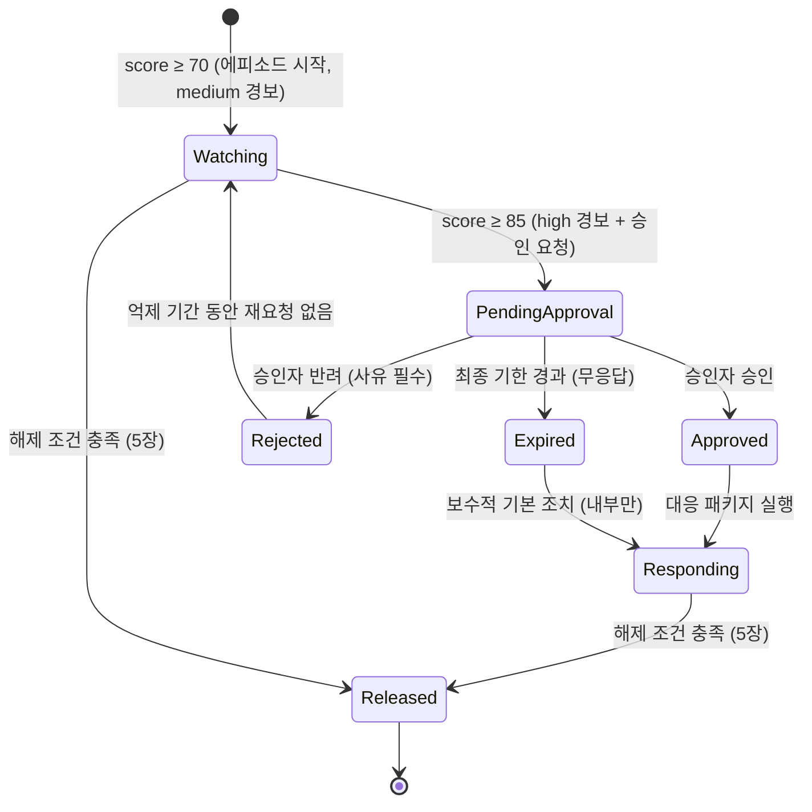

# 대응 매트릭스 v1 — "⑦ 사람 승인 대기 → ⑧ 세 가지 결과"

> 담당: 대응 설계 (Juwan → Sejin 인계) · 작성일 2026-11-06 · 상태: **팀 회의 승인 대기**
> 이 문서는 설계서다. 실제 구현은 ThreatWatch 쪽에서 하며, 이 저장소에서는 `src/adapters/`가
> ScoreEvent → AlertRequest 변환만 담당한다.

표기 규칙
- **[확정]** 팀 회의에서 이미 정해졌거나, 계약(schemas/)·코드에 이미 반영된 전제
- **[제안]** 이 문서가 제안하는 값·규칙. 회의에서 바꿀 수 있음
- **[회의 필요]** 이 문서만으로 정할 수 없어 회의 안건으로 올리는 항목 (끝의 9장에 모음)

## 0. 전제와 용어

| 항목 | 내용 | 상태 |
| --- | --- | --- |
| 경보 트리거 | ScoreEvent의 `threshold_breached == true`, 즉 `risk_score ≥ 70` (`src/engine/risk_score.py`의 `RISK_THRESHOLD`) | [확정] |
| severity 매핑 | 70 이상 → `medium`, 85 이상 → `high` (`src/adapters/threatwatch_sender.py`) | [확정] |
| 사람 승인(HITL) 경로 | `high`만 승인 대기에 들어간다. `medium`은 알림만 | [확정] |
| 계산 주기 | 점수는 온체인 시그널 주기(1시간)마다 계산된다. 위기 중엔 같은 코인의 경보가 매시간 반복될 수 있다 | [확정] |
| alert_id | `AlertRequest.alert_id = ScoreEvent.event_id`. ThreatWatch는 같은 alert_id를 두 번 받으면 두 번째를 무시한다(멱등성) | [확정] |
| 에피소드(episode) | 한 코인이 처음 70 이상이 된 시각부터 5장의 해제 조건을 만족할 때까지의 연속 구간. 경보·승인·해제는 모두 **에피소드 단위**로 센다 | [제안] |
| 역할 | **운영자**: 당직으로 경보를 받고 데이터·시스템을 점검하는 사람 / **승인자**: 대응 실행을 결정할 권한이 있는 사람(자금·준법 책임자) / **백업 승인자**: 승인자가 무응답일 때의 대체자 / **최종 에스컬레이션 대상**: 랩장(운영 단계에서는 사업 책임자) / **일반 사용자**: 서비스에서 USDC를 보유·사용하는 사람 | [제안] |

승인자가 "승인"하는 대상은 **대응 패키지 실행**이다(2장). 점수 계산이나 경보 발송 자체는 승인 대상이
아니며 자동으로 일어난다.

## 1. 점수 구간별 대응표

### 1-1. 운영자

| 구간 | severity | 받을 내용 | 채널 | 해야 할 행동 (체크리스트) | 상태 |
| --- | --- | --- | --- | --- | --- |
| 70 ≤ score < 85 | medium | 코인, 점수, confidence, `top_factors` 상위 3개와 기여도, 에피소드 시작 시각, 직전 24시간 점수 추이 링크 | 운영 채팅 채널(Slack/Teams 등) + 대시보드 배지. 야간에는 푸시 알림 1회 | ① 15분 안에 "확인" 버튼으로 수신 확인(ack) ② `top_factors`의 원천 데이터가 실제인지 점검(거래소 API 장애·시그널 누락이면 오탐 플래그) ③ 최신 준비금 공시의 경과 일수와 발행사 공식 채널 확인 ④ 승인자에게 "주의 단계 진입" 사전 통지(승인 요청 아님) ⑤ 에피소드 노트에 점검 결과 기록 | [제안] |
| 85 ≤ score ≤ 100 | high | medium 내용 + 승인 요청 ID, 응답 기한(2장의 타이머), 승인 시 실행될 대응 패키지 목록 | 운영 채널 + 푸시(무조건) + 승인자에게 별도 승인 요청(2장) | ① 즉시 ack ② medium 체크리스트 ②③을 승인자 응답 전에 끝내고 결과를 승인 요청에 첨부(오탐 근거가 있으면 "반려 권고") ③ 승인 결과에 따라 2장의 다음 행동 실행 ④ 상황실(전용 채널) 개설 | [제안] |

### 1-2. 일반 사용자

| 구간 | 안내 여부 | 내용 | 상태 |
| --- | --- | --- | --- |
| 70 ≤ score < 85 | **안내 없음** | 내부 주의 단계. 사용자에게 보내면 근거 없는 불안만 만든다. 단, 사용자가 먼저 문의하면 상담 창구에 "모니터링 중" 공통 응대문(아래 원칙 적용)을 제공한다 | [제안] |
| 85 ≤ score ≤ 100 | **승인 후에만 안내** | 승인자가 대응 패키지를 승인한 경우에만, 사전 승인된 템플릿으로 1회 발송. 승인 없이 자동 발송하지 않는다 | [제안] |
| 해제 | 위기 중 안내를 보낸 경우에만 "상황 종료" 안내 | 5장 | [제안] |

**사용자 안내 문구 원칙** (템플릿은 준법 검토 후 확정 [회의 필요])

1. **사실만, 출처와 함께**: "현재 USDC 시장가가 1달러보다 낮게 거래되고 있습니다(출처·시각)". 점수·확률·예측은 쓰지 않는다.
2. **행동 지시 없음**: "환매하세요/보유하세요/매도하세요"류 문장 금지. 투자 조언으로 읽히는 표현("손실 예상", "지금이 기회") 금지.
3. **공포 자극 금지**: "붕괴", "폭락", "긴급", 느낌표, 카운트다운, 빨간색 강조 금지. 제목은 "USDC 관련 안내"처럼 중립.
4. **대량 환매를 부추기지 않음**: 환매 창구가 열려 있다는 사실은 알리되 "서두르라"는 뉘앙스 금지. 사용자가 할 수 있는 선택지를 나열만 한다(보유 유지, 발행사 공식 공지 확인, 상담 창구).
5. **발행사 공식 채널 링크**를 반드시 포함하고, 우리 안내보다 발행사 공지가 우선임을 명시.
6. **1회 발송 원칙**: 같은 에피소드에서 사용자 안내는 최대 1회 + 종료 안내 1회. 매시간 반복 발송은 절대 금지(4장).
7. **문의 대응문 동봉**: 상담 창구가 같은 문구로 답할 수 있도록 FAQ를 함께 배포.

온보딩 문서의 "환매 시 예상 손실 vs 대기 시 리스크 안내" 아이디어는 투자 조언 경계에 걸리므로 v1에서는
**채택하지 않는다**. 준법 검토 결과에 따라 v2에서 재논의. [회의 필요]

## 2. 85점 이상: 사람 승인 흐름과 세 가지 결과

### 2-1. 상태 전이

### 2-2. 승인 요청에 들어갈 내용 [제안]

- 코인, 점수, confidence, `top_factors`, 에피소드 시작 시각, 점수 추이(최근 24시간)
- 운영자 점검 결과(오탐 여부, 데이터 원천 상태) — 운영자가 아직 입력 전이면 "점검 중" 표시
- 승인 시 실행될 **대응 패키지**(아래) 목록과 사용자 안내 템플릿 미리보기
- 응답 기한(3장)과 무응답 시 일어날 일

### 2-3. 세 가지 결과

| 결과 | 조건 | 다음 행동 | 기록 항목 | 상태 |
| --- | --- | --- | --- | --- |
| **승인 (approved)** | 승인자(또는 백업 승인자)가 기한 내 승인 | **대응 패키지 실행**: ① 일반 사용자 상황 안내 1회 발송(1-2 원칙) ② 자금팀에 USDC 노출 축소 검토 요청(실행은 자금팀 판단) ③ 준법팀에 사실 통지 ④ 상황실 유지, 이후 시간별 점수는 상황실에만 게시 | 결정자, 결정 시각, 요청→결정 소요 시간, 실행된 패키지 항목과 각 실행 시각, 사용자 안내 발송 건수·템플릿 버전 | [제안] |
| **반려 (rejected)** | 승인자가 기한 내 반려. **사유 선택 필수**(오탐/데이터 장애/이미 대응 중/기타+자유 기입) | ① 사용자 안내 없음 ② 에피소드는 Watching으로 복귀(종료가 아님) ③ 같은 에피소드에서 재승인 요청은 4-3의 승격 규칙에 해당할 때만 ④ 오탐 사유면 엔진 담당에게 데이터 패키지(ScoreEvent + 원천 시그널) 자동 전달 | 결정자, 시각, 사유 코드, 자유 기입, 첨부된 운영자 점검 결과 | [제안] |
| **만료 (expired)** | 3장의 최종 기한까지 승인자·백업 승인자 모두 무응답 | ① "무응답"을 결과로 기록하고 최종 에스컬레이션 대상(랩장)에게 통지 ② **보수적 기본 조치**: 자금팀 노출 축소 검토 요청 + 상황실 유지 (내부 조치만) ③ 사용자 안내는 **보내지 않는다** — 외부 커뮤니케이션은 사람이 결정한다는 원칙 ④ 승인 요청은 만료 상태로 닫고, 다음 시간 점수가 여전히 85 이상이면 **새 승인 요청**을 랩장을 수신자에 포함해 발송 | 만료 시각, 재알림 횟수와 각 시각, 에스컬레이션 수신자, 기본 조치 실행 여부 | [제안] · 기본 조치 범위는 [회의 필요] |

만료 시 사용자 안내를 자동으로 보낼지는 양쪽 위험이 있다(무응답으로 안내가 늦어지는 위험 vs 사람
검토 없는 외부 공지가 공포를 만드는 위험). 이 문서는 **보내지 않음**을 기본값으로 제안한다. [회의 필요]

## 3. 만료·재알림 규칙 ("무응답도 하나의 결과")

기준 시각 T0 = 승인 요청 발송 시각. 근거: 2023-03 사태에서 온체인 데이터 기준 리드타임이 최대 약
3시간이므로, 승인 흐름 전체가 1시간 안에 끝나야 대응이 의미가 있다.

| 시점 | 행동 | 수신자 | 채널 | 상태 |
| --- | --- | --- | --- | --- |
| T0 | 승인 요청 #1 | 승인자 | 푸시 + 운영 채널 + 문자(SMS) | [제안] |
| T0 + 10분 | 재알림 #1 | 승인자 | 푸시 + 전화(자동 음성) | [제안] |
| T0 + 20분 | 재알림 #2 + **백업 승인자 동시 수신 시작** | 승인자, 백업 승인자 | 푸시 + 전화 | [제안] |
| T0 + 40분 | 재알림 #3 (최후 통보: "20분 후 만료") | 승인자, 백업 승인자, 운영자 | 푸시 + 전화 | [제안] |
| T0 + 60분 | **만료** → 2-3 만료 행동. 랩장 통지 | 랩장 + 전원 | 푸시 + 전화 + 운영 채널 | [제안] |

- 재알림 횟수 3회, 간격 10/10/20분, 총 대기 60분. 숫자는 [회의 필요], 구조(단계적 수신자 확대 + 명시적 만료)는 [제안].
- 승인자와 백업 승인자 중 **먼저 응답한 결정이 유효**하고, 나머지에게는 "이미 처리됨"을 보낸다.
- 야간·주말 당직표(누가 승인자/백업인지)는 ThreatWatch 설정값이지 이 문서의 범위가 아니다. 다만 "당직자가 비어 있으면 승인 요청 발송 시점에 즉시 랩장으로 간다"는 규칙은 포함한다.
- 승인자가 "검토 중(15분 연장)"을 누를 수 있게 한다. 연장은 **1회만**, 최종 만료는 T0 + 75분을 넘지 않는다. [제안]

## 4. 중복·연속 경보 처리

### 4-1. 왜 필요한가 — 2023-03 데이터의 실제 모양

베이스라인 엔진(`src/engine/risk_score.py`)을 `data/historical/signals_usdc_2023_depeg_hourly.json`에
시간별로 돌린 결과(온체인 price·pegdev만 있으므로 최대 50점):

| 시각(UTC) | 가격 | 점수 | 비고 |
| --- | ---: | ---: | --- |
| 03-11 05:00 | 0.9862 | 13.8 | 첫 이탈 신호 |
| 03-11 06:00 | 0.9330 | 50.0 | 포화(500bps 이상) |
| 03-11 08:00 | 0.8627 | 50.0 | 최저가 |
| 03-11 21:00 | 0.9733 | 26.7 | **1시간 반등 후 다시 50** |
| 03-12 02:00 ~ 06:00 | 0.985 ~ 0.98 | 15 ~ 20 | **5시간 완화 후 03-12 08:00에 다시 50** |
| 03-13 15:00 | 0.9992 | 0.8 | 사실상 회복 |

위기 구간 약 60시간 동안 점수가 "높음"에 머문 시간이 40시간 이상이다. 규칙이 없으면 같은 코인의
경보가 40번 넘게 나가고, 반등 때마다 "종료"와 "재발"이 반복된다.

### 4-2. alert_id 멱등성이 막아 주는 것과 막지 못하는 것 [확정 사실 + 제안]

- `event_id`는 엔진이 계산할 때마다 새로 만드는 UUID다(`uuid.uuid4()`). 따라서 ThreatWatch의
  alert_id 멱등성은 **같은 ScoreEvent의 재전송**(네트워크 재시도, 큐 중복 전달)만 막는다.
- 매시간 새로 계산된 ScoreEvent는 매번 다른 event_id를 가지므로 **시간별 반복 경보는 멱등성으로
  걸러지지 않는다**. 중복 처리는 ThreatWatch 쪽의 **에피소드 규칙**으로 해야 한다.
- 어댑터·엔진에 대한 의견(이 문서에서 바꾸지 않음): `event_id`를 `coin + scored_at`의 결정적
  해시로 만들면 "같은 시각의 재계산"까지 멱등하게 된다. 지금은 같은 입력을 두 번 계산하면 두 개의
  경보가 된다. [회의 필요]

### 4-3. 에피소드 규칙 [제안]

| 규칙 | 내용 |
| --- | --- |
| 에피소드 키 | `coin`. 한 코인에 열린 에피소드는 동시에 하나만 존재 |
| 시작 | 열린 에피소드가 없는데 `threshold_breached` 이벤트가 오면 에피소드 생성 → medium 경보 1회(1-1) |
| 같은 구간 반복 | 에피소드가 열린 동안 같은 severity의 이벤트는 **새 경보를 내지 않고** 에피소드에 "업데이트"로 붙인다. 운영 채널에는 6시간마다 요약 1건(최고점·현재점·추이), 점수가 직전 게시 대비 ±10 이상 바뀌면 즉시 1건 |
| 승격 (70대 → 85+) | 에피소드 안에서 **처음** 85 이상이 되는 순간 high 경보 + 승인 요청(2장). 승격은 쿨다운의 영향을 받지 않는다(항상 즉시) |
| 승인 후 | Approved 상태에서는 점수가 아무리 올라도 승인 요청을 다시 내지 않는다. 상황실에 시간별 점수만 게시 |
| 반려 후 재요청 | 반려 뒤에는 **억제 기간 6시간** 동안 같은 에피소드에서 승인 요청을 내지 않는다. 예외: 점수가 반려 시점보다 10 이상 높아지거나 95 이상이 되면 즉시 재요청(반려 사유를 첨부). 억제 기간 수치는 [회의 필요] |
| 만료 후 재요청 | 2-3 만료 행동대로 다음 시간 이벤트가 85 이상이면 새 승인 요청(랩장 포함). 이후에는 반려 후와 같은 억제 규칙 적용 |
| 강등 (85+ → 70대) | 에피소드는 유지. PendingApproval 중이면 승인 요청도 유지(점수가 내려갔다고 요청을 취소하지 않는다 — 4-1의 반등 패턴 때문). 운영 채널에 "완화" 업데이트 1건 |
| 새 에피소드 | 5장의 해제 뒤에 다시 70 이상이 되면 새 에피소드. 직전 에피소드 ID를 `previous_episode_id`로 연결해 재발임을 표시 |

## 5. 해제 규칙 ("상황 종료")

4-1에서 본 것처럼 점수는 1~5시간짜리 완화를 끼고 다시 오른다. 70 아래로 내려간 첫 시간에 종료를
알리면 2023-03-12 새벽에 "종료"를 보내고 두 시간 뒤 다시 경보를 내야 했을 것이다.

| 규칙 | 내용 | 상태 |
| --- | --- | --- |
| 해제 조건 | `risk_score < 60`이 **연속 6회(6시간)** 이상 | [제안] · 60/6 수치는 [회의 필요] |
| 이력(hysteresis) | 진입은 70, 해제는 60. 60~70 사이에서는 "완화 중"으로만 표시하고 종료하지 않음 | [제안] |
| 해제 시 운영자 | 즉시 "상황 종료" 게시 + 에피소드 요약(시작·최고점·승인 결과·사용자 안내 여부·총 시간) + 사후 검토(post-mortem) 템플릿 링크 | [제안] |
| 해제 시 승인자 | 에피소드에서 승인 요청이 있었던 경우에만 종료 통지 | [제안] |
| 해제 시 일반 사용자 | **위기 중 사용자 안내를 보낸 에피소드에서만** 종료 안내 1회. 문구는 1-2 원칙(사실·출처·중립). "안전합니다/해결됐습니다" 같은 보증 표현 금지, "모니터링을 평상 수준으로 되돌렸습니다" 수준 | [제안] |
| 종료 안내 승인 | 사용자 종료 안내는 운영자 1인의 확인(원클릭)으로 발송. 전체 승인 흐름을 다시 돌리지 않는다 | [제안] · [회의 필요] |
| 데이터 장애로 인한 점수 하락 | 시그널이 끊겨 점수가 0이 되는 경우는 해제가 아니다. 엔진 `confidence`가 직전 대비 급락하면 해제 카운트를 멈추고 운영자에게 "데이터 결손" 경고 | [제안] · 엔진에 confidence 산식 의견 필요 |

## 6. 85점 기준 검토 의견 (팀 회의 제출용)

### 6-1. 지금 말할 수 있는 것

- `Jaeseok/engine-backtest-usdc` 브랜치에는 2026-11-06 현재 main 이후 커밋이 없어 **백테스트 결과가 없다**.
- 베이스라인 엔진으로 직접 돌린 결과(4-1): 온체인 시그널만으로는 **최대 50점**이라 70도 85도 넘지 않는다. `peg_deviation_bps` 가중치 0.5 × 정규화 상한 1.0 = 50이 구조적 상한이다. 즉 현재 엔진으로는 "85를 최저점 몇 시간 전에 넘었나"를 계산할 수 없고, 질문 자체가 엔진 재교정 뒤에만 성립한다.
- 온체인 신호의 시간 구조는 분명하다: 첫 이탈(05:00Z) → 포화(06:00Z) → 최저점(08:00Z). **리드타임은 최대 3시간**이고, 포화 기준으로는 2시간이다. 어떤 임계값을 쓰든 온체인만으로는 이 벽을 넘지 못한다.
- 따라서 85점 기준의 타당성은 임계값 숫자보다 **오프체인 시그널(뉴스 플래그, 준비금 공시)이 05:00Z보다 얼마나 앞서 켜지느냐**에 달려 있다. 2023-03-10 밤(UTC 03-11 새벽) SVB 노출 보도가 그 후보다.

### 6-2. 의견

1. 85는 "승인 요청을 낼 만큼 확실한가"의 기준이지 "조기 경보"의 기준이 아니다. 조기성은 70(medium)과 그 아래 운영자 모니터링이 담당해야 하므로, **70/85 자체를 지금 바꿀 이유는 없다**. 숫자를 바꾸기 전에 엔진을 재교정해야 한다.
2. 70~85 구간이 2023 데이터에서 **실제로 한 번이라도 나타나는지**를 재교정 결과로 확인해야 한다. 포화형 지표만 있으면 점수가 0 → 50(또는 0 → 100)으로 뛰어 medium 단계가 비게 되고, 그러면 1장의 2단계 설계가 무의미해진다.
3. 85가 울리는 시각이 최저점보다 1시간 이내로 늦으면 3장의 60분 승인 흐름은 최저점 뒤에 끝난다. 그 경우 85의 역할은 "사전 대응"이 아니라 "사후 커뮤니케이션 승인"이 되며, 대응 패키지의 내용(노출 축소 vs 사용자 안내)도 그에 맞게 바뀌어야 한다.

### 6-3. 판단에 필요한 데이터 목록 (엔진 담당에게 요청)

| # | 데이터 | 용도 |
| --- | --- | --- |
| 1 | 재교정 엔진의 시간별 점수: 2023-01-15~02-12(평시), 2023-03-09~03-14(위기), 오프체인 시그널 결합본 | 70/85 교차 시각, 리드타임 |
| 2 | 평시 구간에서 70·85를 넘은 횟수와 시각 | 오탐률 → 승인자 피로도, 억제 기간(4-3) 설계 |
| 3 | 위기 구간에서 85 이상에 머문 연속 시간, 60 아래로 떨어진 구간의 길이 | 쿨다운·해제 수치(5장) 교정 |
| 4 | 각 시각의 `confidence`와 시그널 커버리지 | 5장의 데이터 결손 규칙 |
| 5 | 오프체인 시그널의 실제 발생 시각(news_risk_flag가 켜진 시각, 공시 발행일 기반 attestation_age) | 온체인 3시간 벽을 넘을 수 있는지 |
| 6 | 가능하면 2022-05 UST 사태의 같은 표 | 임계값이 한 사건에 과적합되지 않았는지 |

## 7. ThreatWatch 구현 담당에게 넘길 요구사항

### 7-1. 입력 필드 (AlertRequest에서 받는 것과 추가로 필요한 것)

| 필드 | 출처 | 비고 |
| --- | --- | --- |
| `alert_id`, `incident_type`, `severity`, `timestamp`, `indicators`, `description` | 현재 AlertRequest | `incident_type`에서 코인을 파싱(`stablecoin_depeg_risk_usdc`) |
| `risk_score`, `confidence` (숫자) | 현재는 `description` 문자열 안에만 있음 | **에피소드 규칙(±10, 95 이상, confidence 급락)을 계산하려면 숫자 필드가 필요**. AlertRequest 스키마에 추가하거나 description 파싱 규칙을 확정해야 함 [회의 필요] |
| `episode_id` | ThreatWatch가 생성 | `coin + 에피소드 시작 scored_at` |

### 7-2. 채널

- 운영 채팅 채널(요약·업데이트·종료), 대시보드 배지, 푸시, SMS, 자동 음성 전화(재알림 #1 이후)
- 승인 UI: 승인 / 반려(사유 코드 + 자유 기입) / 검토 중 15분 연장 — 모바일에서 동작해야 함
- 일반 사용자 발송 채널(앱 공지·이메일)은 **ThreatWatch가 직접 보내지 않고** 서비스 쪽 발송 API를 호출. 템플릿 버전을 기록

### 7-3. 타이머

| 타이머 | 값(제안) | 시작 | 동작 |
| --- | --- | --- | --- |
| ack 기한 | 15분 | 경보 발송 | 미확인 시 운영자 재알림, 그래도 없으면 백업 운영자 |
| 재알림 | T0+10, +20, +40분 | 승인 요청 | 3장 수신자 확대 |
| 최종 만료 | T0+60분 (연장 시 +75분) | 승인 요청 | 2-3 만료 행동 |
| 반려 억제 | 6시간 | 반려 | 4-3 |
| 요약 게시 | 6시간 | 에피소드 시작 | 4-3 |
| 해제 카운트 | 60점 미만 연속 6회 | 매 이벤트 | 5장 |

### 7-4. 기록해야 할 상태값 (감사 로그, 변경 불가 저장)

- 에피소드: `episode_id`, `coin`, `started_at`, `peak_score`, `peak_at`, `current_state`(Watching/PendingApproval/Approved/Rejected/Expired/Responding/Released), `released_at`, `previous_episode_id`
- 경보 수신: 모든 `alert_id`와 수신 시각, 에피소드에 "업데이트"로 흡수됐는지 여부, 중복(멱등성) 거부 여부
- 승인 요청: `approval_id`, `requested_at`, 수신자 목록, 재알림 각 시각·채널·수신자, 연장 여부, `decided_at`, `decided_by`, `decision`(approved/rejected/expired), 사유 코드·자유 기입, 첨부된 운영자 점검 결과
- 대응 실행: 패키지 항목별 실행 시각·결과, 사용자 안내 발송 건수·템플릿 버전·발송 승인자
- 해제: 해제 판정에 쓰인 6개 이벤트의 `alert_id`, 종료 안내 발송 여부·확인자
- 데이터 결손 경고: 발생 시각, 당시 `confidence`, 해제 카운트 정지 여부

### 7-5. ThreatWatch 기존 HITL과의 차이 (구현 시 주의)

- ThreatWatch는 "P1 알림 1건 = 승인 1건"이지만, 여기서는 **에피소드 1건 = 승인 요청 0~N건**(반려·만료 후 재요청)이다. 승인 요청과 경보를 1:1로 묶지 말 것.
- 만료 결과가 "아무 일도 안 함"이 아니라 **내부 기본 조치 + 랩장 통지**라는 점.
- 승인 대상이 "알림 처리"가 아니라 "대응 패키지 실행"이며, 외부 사용자 발송이 포함되므로 승인 UI에 템플릿 미리보기가 있어야 한다.

## 8. 어댑터·엔진에 대한 의견 (이 PR에서 수정하지 않음)

1. `event_id`를 `coin + scored_at`의 결정적 값으로 만들면 재계산·재전송 모두 멱등해진다(4-2).
2. AlertRequest에 `risk_score`, `confidence` 숫자 필드가 없으면 ThreatWatch가 description을 파싱해야 한다. 스키마 사본은 랩장이 게이트웨이 원본과 맞추는 항목이므로, 추가 가능 여부를 확인해 달라.
3. 포화형 정규화(500bps = 1.0)는 점수를 0↔50으로 뛰게 해 medium 구간을 비운다. 70~85가 실제로 존재하도록 정규화 곡선을 완만하게 하는 것을 검토해 달라.
4. `confidence`가 시그널 개수만 세는 지금 산식으로는 5장의 "데이터 결손" 판정에 쓸 수 없다. 커버리지(기대 시그널 대비 실제) 기반이 필요하다.

## 9. 팀 회의 안건 (결정 필요 항목 모음)

| # | 안건 | 이 문서의 제안 |
| --- | --- | --- |
| A | 역할 지정: 승인자·백업 승인자·최종 에스컬레이션 대상이 누구인가(실습 단계·운영 단계 각각) | 승인자=자금·준법 책임자, 백업=당직 운영 책임자, 최종=랩장 |
| B | 만료 시 기본 조치 범위 — 내부 조치만 할지, 사용자 안내도 자동 발송할지 | 내부만 |
| C | 승인 대기 시간과 재알림: 10/20/40분, 60분 만료, 연장 1회 15분 | 제안값 채택 |
| D | 반려 후 억제 기간 6시간, 예외(+10점 또는 95점) | 제안값 채택 |
| E | 해제 조건: 60점 미만 연속 6시간 (진입 70 / 해제 60 이력) | 제안값 채택 |
| F | 사용자 종료 안내를 운영자 원클릭으로 보낼지, 승인자 승인을 다시 받을지 | 운영자 원클릭 |
| G | 사용자 안내 템플릿과 FAQ 문안의 준법 검토 주체·일정 | 회의에서 지정 |
| H | "환매 시 예상 손실 vs 대기 리스크" 안내를 v1에서 제외하는 데 동의하는지 | 제외 |
| I | `event_id` 결정적 생성, AlertRequest `risk_score`·`confidence` 숫자 필드 추가 (어댑터·스키마 담당) | 추가 권고 |
| J | 엔진 재교정 뒤 6-3의 데이터로 85점 기준을 재검토하는 일정 | 백테스트 결과 제출 후 다음 회의 |
